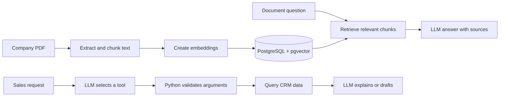

# LeadPilot AI

**A practical CRM with an AI sales assistant grounded in your data.**

Track leads, ask questions about company PDFs, and draft personalized follow-ups from one Streamlit app. LeadPilot keeps lead records, document vectors, conversation history, and preferences in PostgreSQL. The assistant can request a small set of validated Python tools; it never sends email.

Built with Python, Streamlit, PostgreSQL, pgvector, PyMuPDF, and the OpenAI API.

## The Product

| Workspace | What you can do |
| --- | --- |
| **Lead Dashboard** | Create, edit, delete, and filter leads by status, priority, and overdue follow-up date. |
| **Document Chat** | Upload a PDF, retrieve relevant passages, and get answers with source references. |
| **AI Sales Assistant** | Find overdue leads, look up lead details, and draft follow-up emails using real CRM data. |
| **Memory and History** | Keep conversations across sessions and save an email tone preference. |

## Under the Hood



The model does not run SQL or send messages. The application validates tool arguments, executes predefined Python functions, and returns the result to the model.

## Run Locally

### Requirements

- Python 3.11 or newer
- Docker Desktop for the bundled PostgreSQL + pgvector service, or another PostgreSQL instance with pgvector enabled
- An OpenAI API key for chat, embeddings, and AI-assisted features

### 1. Install Python dependencies

```powershell
git clone https://github.com/HIMANSHI549/leadPilot.git
cd leadPilot
python -m venv .venv
.\.venv\Scripts\Activate.ps1
pip install -r requirements.txt
```

On macOS or Linux, activate the environment with `source .venv/bin/activate`.

### 2. Configure local settings

```powershell
copy .env.example .env
```

Edit `.env` and set `OPENAI_API_KEY`, `POSTGRES_USER`, and `POSTGRES_PASSWORD`. Choose a local database password, then set `DATABASE_URL` to connect with those same values. `POSTGRES_DB` defaults to `leadpilot`. The committed `.env.example` contains placeholders; keep your real values in `.env`, which is ignored by Git.

### 3. Start the database and app

```powershell
docker compose up -d
streamlit run app.py
```

Open the local URL printed by Streamlit, usually http://localhost:8501. On first launch, LeadPilot creates the schema and seeds fictional sample leads.

### 4. Run tests

```powershell
pytest
```

## Take a Tour

1. In **Lead Dashboard**, edit a sample lead and filter for overdue follow-ups.
2. In **Document Chat**, load `data/sample_company_profile.pdf` and ask: “What is included in the 14-day pilot?” Check the cited source.
3. In **AI Sales Assistant**, ask which leads are more than three days overdue, then request a draft for a lead by ID.
4. In **Memory and History**, save a friendly email tone and use it in a later draft.

The app is designed for one local user. It stores data in PostgreSQL and does not send emails. OpenAI API calls may incur charges; set a usage budget before experimenting.

## Project Map

| Path | Responsibility |
| --- | --- |
| `app.py`, `pages/` | Streamlit navigation and the four user-facing workflows |
| `src/database.py`, `src/lead_service.py` | PostgreSQL connections and CRM queries |
| `src/llm_service.py`, `src/tools.py` | LLM requests and validated tool execution |
| `src/rag_service.py` | PDF extraction, chunking, embeddings, retrieval, and sourced answers |
| `src/memory_service.py` | Conversation history and saved preferences |
| `sql/schema.sql` | PostgreSQL and pgvector schema |
